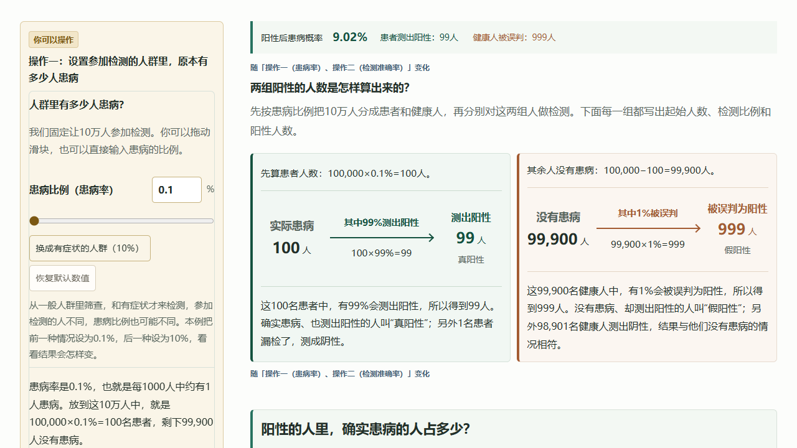
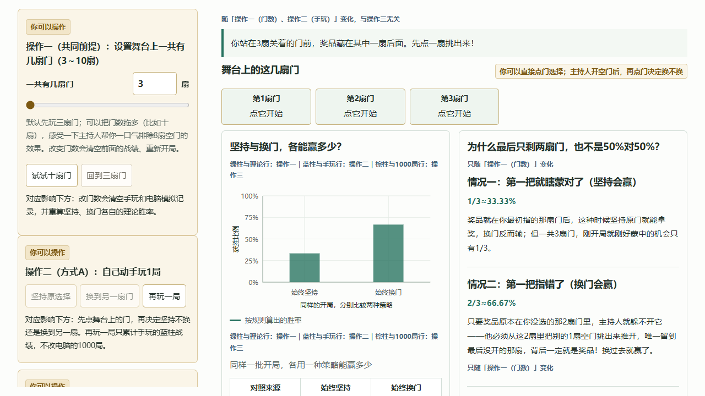
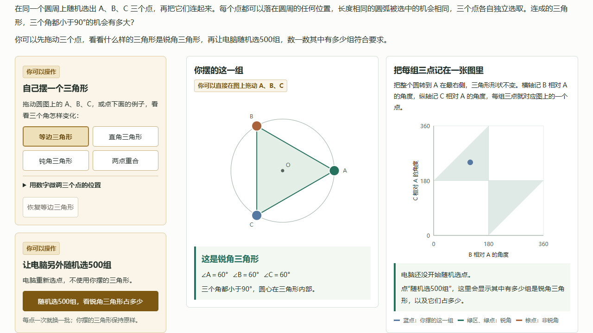
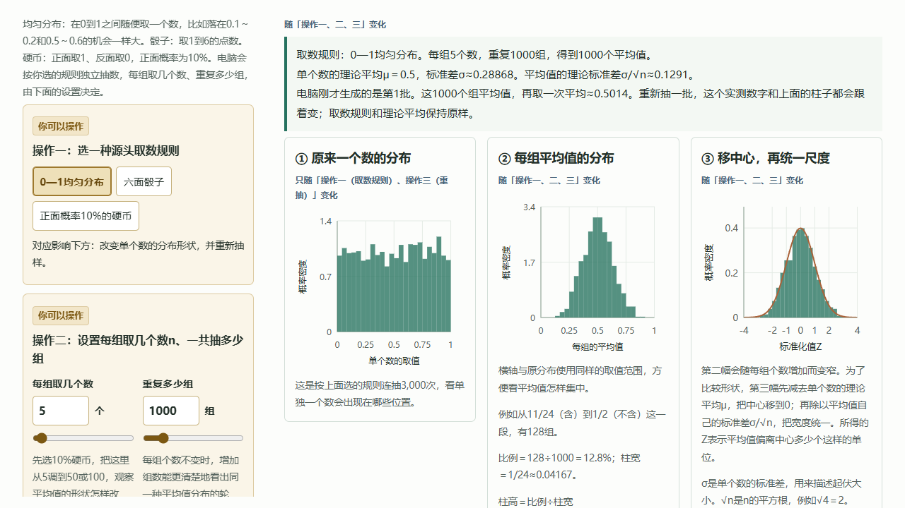

# 看得见的概率论

**通过网页交互理解原理 · 武辰**

39个免费的概率论与统计交互实验，另有1个医院补充例子。不用安装软件，也不用写代码，打开网页就能调整参数、拖动图形，观察计算结果怎样变化。

**[打开全部交互实验](https://wuchen2018.github.io/visual-probability/)**

你可以从感兴趣的问题开始，也可以按《大白话概率论》的章节查找。各实验保留对应章节和样章说明；有公开样章的小节，可以直接打开PDF。

## 先试这四个实验

| [检测阳性，患病概率是多少？](https://wuchen2018.github.io/visual-probability/bayes/) | [三门问题，为什么应该换门？](https://wuchen2018.github.io/visual-probability/monty-hall/) |
| --- | --- |
| [](https://wuchen2018.github.io/visual-probability/bayes/) | [](https://wuchen2018.github.io/visual-probability/monty-hall/) |
| [圆周随机三点，连成锐角三角形的机会是多少？](https://wuchen2018.github.io/visual-probability/puzzle-acute-triangle/) | [一组数取平均，重复很多组后会长什么样？](https://wuchen2018.github.io/visual-probability/central-limit/) |
| [](https://wuchen2018.github.io/visual-probability/puzzle-acute-triangle/) | [](https://wuchen2018.github.io/visual-probability/central-limit/) |

## 全部实验

### 几何概型与随机方法

| 问题 | 对应小节 |
| --- | --- |
| [先到的人最多等15分钟，两人能碰面的机会有多大？](https://wuchen2018.github.io/visual-probability/geometric-probability/) | 2.3 |
| [在圆里随机画一条弦，为什么会有三个答案？](https://wuchen2018.github.io/visual-probability/bertrand-chord/) | 2.4 |

### 条件概率与反直觉

| 问题 | 对应小节 |
| --- | --- |
| [检测阳性，患病概率是多少？](https://wuchen2018.github.io/visual-probability/bayes/) | 3.4 |
| [用同一枚硬币连抛两次，先看清是哪种硬币，会改变判断吗？](https://wuchen2018.github.io/visual-probability/conditional-independence/) | 3.5.1 |
| [筛选怎样改变散点图？](https://wuchen2018.github.io/visual-probability/berkson/) | 3.5.2 |
| [分组和合并比较为什么会反转？](https://wuchen2018.github.io/visual-probability/simpson/) | 3.5.3 |
| [从至少一个男孩到星期二男孩，概率为什么从1/3变成13/27？](https://wuchen2018.github.io/visual-probability/tuesday-boy/) | 3.6 |
| [只剩两扇关着的门，为什么换门更容易赢？](https://wuchen2018.github.io/visual-probability/monty-hall/) | 3.7 |

### 数字特征与大模型

| 问题 | 对应小节 |
| --- | --- |
| [取绝对值与平方，会选同一个最优中心吗？](https://wuchen2018.github.io/visual-probability/variance-squared/) | 5.2 |
| [两组数怎样一起变化？拖动散点看一看](https://wuchen2018.github.io/visual-probability/correlation/) | 5.3 |
| [两个方向有多接近？拖动向量试试](https://wuchen2018.github.io/visual-probability/cosine/) | 5.4 |
| [缺考0分会改变什么？大象和蚂蚁谁更分散？](https://wuchen2018.github.io/visual-probability/outliers-and-cv/) | 5.5 |
| [相关系数是0，两个数就互不相干吗？](https://wuchen2018.github.io/visual-probability/correlation-causation/) | 5.6 |

### 常见分布与多维分布

| 问题 | 对应小节 |
| --- | --- |
| [抽完放回与不放回，中奖概率差在哪儿？](https://wuchen2018.github.io/visual-probability/binomial-hypergeometric/) | 6.2、6.4 |
| [平均每小时3通电话，实际会来几通？](https://wuchen2018.github.io/visual-probability/poisson-distribution/) | 6.3 |
| [平均20抽出金，前20抽就一定能出吗？](https://wuchen2018.github.io/visual-probability/geometric-distribution/) | 6.5 |
| [已经等了一小时，再等一小时的概率会变吗？](https://wuchen2018.github.io/visual-probability/exponential/) | 7.2 |
| [两门考试都考85分，表现一样好吗？](https://wuchen2018.github.io/visual-probability/normal-distribution/) | 7.3 |
| [看到正反面结果后，对未知概率的猜测怎样改变？](https://wuchen2018.github.io/visual-probability/beta/) | 7.5 |
| [长尾到底有多长？把两种尾部放在一起看](https://wuchen2018.github.io/visual-probability/power-law/) | 7.7 |
| [知道两件事在一起，怎样只看其中一件？](https://wuchen2018.github.io/visual-probability/joint-distributions/) | 9.1—9.4 |

### 极限定理与直觉陷阱

| 问题 | 对应小节 |
| --- | --- |
| [抛的次数多了，正面频率会怎样变化？](https://wuchen2018.github.io/visual-probability/large-numbers/) | 12.1 |
| [一组数取平均，重复很多组后会长什么样？](https://wuchen2018.github.io/visual-probability/central-limit/) | 12.4 |
| [完全随机的结果，为什么也会有偏差和扎堆？](https://wuchen2018.github.io/visual-probability/clustering-illusion/) | 14.1 |
| [本金有限，反复玩下去会怎样？](https://wuchen2018.github.io/visual-probability/gamblers-ruin/) | 14.2 |

### 熵与信息论

| 问题 | 对应小节 |
| --- | --- |
| [四种结果，什么时候最难猜？](https://wuchen2018.github.io/visual-probability/entropy/) | 15.1 |
| [知道硬币结果，消息还剩多少不确定性？](https://wuchen2018.github.io/visual-probability/mutual-information/) | 15.2 |
| [换一个方向算，信息代价为什么会不同？](https://wuchen2018.github.io/visual-probability/kl-divergence/) | 15.3 |

### 样本、估计、检验与回归

| 问题 | 对应小节 |
| --- | --- |
| [用这几个人的平均数算方差，为什么会偏小？](https://wuchen2018.github.io/visual-probability/sample-variance-n-minus-1/) | 16.2 |
| [已经看到几次正面，怎样反过来猜硬币？](https://wuchen2018.github.io/visual-probability/maximum-likelihood/) | 17.2 |
| [只看到几个数，怎样猜出原来的上限？](https://wuchen2018.github.io/visual-probability/estimator-criteria-tank/) | 17.3 |
| [95%置信区间里的95%，指的是什么？](https://wuchen2018.github.io/visual-probability/confidence-interval/) | 17.4 |
| [一轮显著和反复测试后挑一轮，有什么区别？](https://wuchen2018.github.io/visual-probability/hypothesis-testing/) | 18.1 |
| [喝咖啡和加班，在这张调查表里有没有关联？](https://wuchen2018.github.io/visual-probability/chi-square-independence/) | 18.2 |
| [三个班的平均分不同，能认定教学方法有差别吗？](https://wuchen2018.github.io/visual-probability/one-way-anova/) | 19.1 |
| [自己调直线，能把六个误差的平方和压到多少？](https://wuchen2018.github.io/visual-probability/linear-regression/) | 19.2 |

### 概率谜题

| 问题 | 对应小节 |
| --- | --- |
| [随机切两刀，三段能围成三角形的机会是多少？](https://wuchen2018.github.io/visual-probability/puzzle-broken-stick/) | 20.4A |
| [集齐5种等概率卡片，为什么平均要11盒多？](https://wuchen2018.github.io/visual-probability/puzzle-coupon-collector/) | 20.4B |
| [圆周随机三点，连成锐角三角形的机会是多少？](https://wuchen2018.github.io/visual-probability/puzzle-acute-triangle/) | 20.4C |

另有[伯克森悖论的医院补充例子](https://wuchen2018.github.io/visual-probability/berkson/hospital.html)。

## 离线使用

在仓库上方点击 Code，选择 Download ZIP，解压后双击 `docs/index.html` 就能打开目录。实验页面可以直接离线操作；样章PDF、GitHub等外部链接需要联网。

## 修改源码和本地构建

需要安装 Node.js 20 或更新版本。本项目的构建和预览使用 Node.js 自带模块，无需安装额外依赖。

```sh
npm run build
npm run preview
```

第一条命令根据 `src/` 中的HTML、CSS和JavaScript生成 `docs/`。第二条命令启动本地预览，在浏览器打开 `http://127.0.0.1:4173`。

- `src/probability/`：实验源码与共享样式、计算和绘图代码。
- `src/catalog.json`、`src/catalog.html`：实验清单与目录页面。
- `docs/`：可直接打开或部署的静态网页。
- `scripts/`：构建和本地预览脚本。

## 与《大白话概率论》的关系

这些交互实验最初为《大白话概率论》制作，现以《看得见的概率论》作为独立项目免费公开。你可以直接使用网页，也可以配合纸书学习。

[图书介绍、目录与样章](https://github.com/wuchen2018/probability-book) · [书中的Python实验代码](https://github.com/wuchen2018/probability-book/tree/main/code)

书中原有的配套资料入口继续保留。

## 使用许可

程序代码采用 [MIT 许可](LICENSE)。本项目中的原创讲解文字与自制图表采用 [CC BY-NC-SA 4.0](LICENSE-CONTENT.md)：转载或改编时注明作者武辰，限非商业用途，并使用相同许可。外部链接中的图书样章不在本项目授权范围内。
